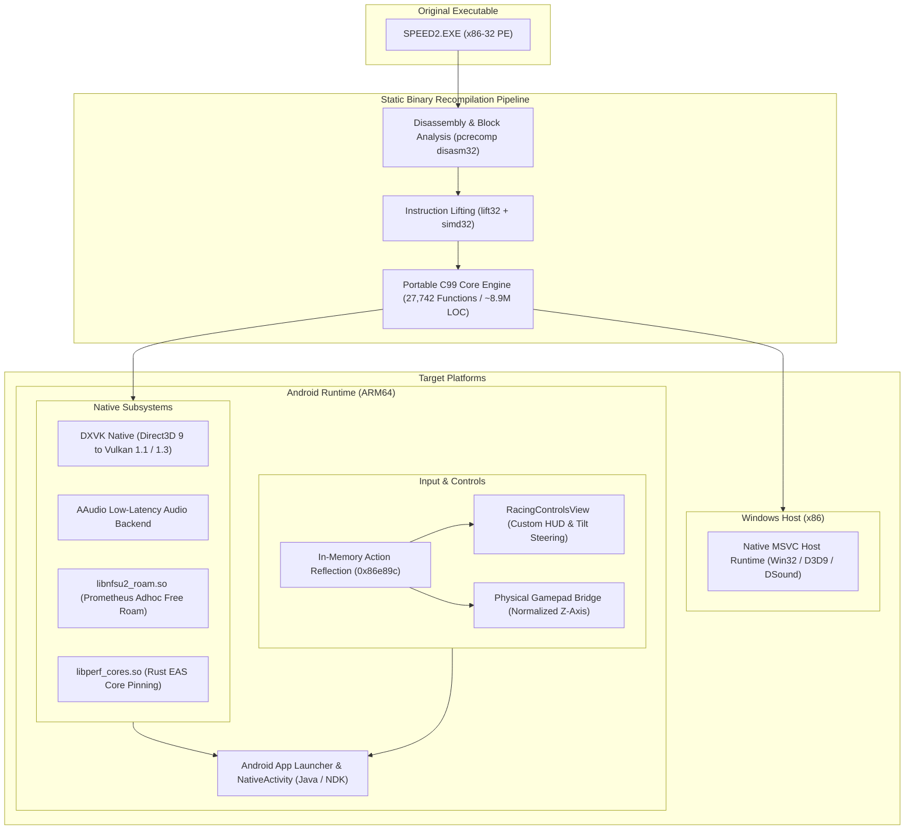
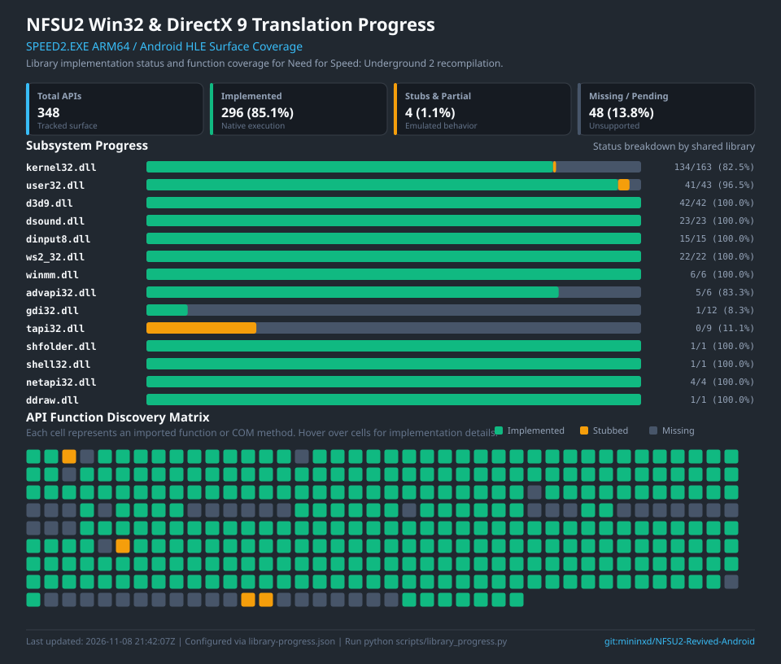

<div align="center">

# Need for Speed Underground 2 — Revived (Android)

### Static Recompilation of SPEED2.EXE into Native C (x86 & ARM64)

[](#requirements)
[-orange.svg)](#features)
[](#features)
[](#features)
[](https://github.com/mininxd/NFSU2-Revived-Android/releases/latest)
[-lightgrey.svg)](#legal--disclaimer)

<p>
  <em>NFSU2 Revived is a native ARM64 Android port of <strong>Need for Speed: Underground 2</strong> (x86-32 <code>SPEED2.EXE</code>), statically recompiled into portable C with Vulkan graphics acceleration, low-latency audio, native free-roam multiplayer, and customizable touch and gamepad controls.</em>
</p>

[⚡ Features](#features) • [📥 Downloads](#downloads) • [📱 Android Setup](#android-setup-guide) • [🏗️ Architecture](#architecture-overview) • [📊 Status](#project-status) • [🛠️ Build](#building-from-source) • [👥 Credits](#credits--attribution) • [⚖️ Legal](#legal--disclaimer)

---

</div>

## Downloads

| Package | Target ABI | Minimum Requirements | Link |
|---|---|---|---|
| **NFSU2 Revived APK** | `arm64-v8a` | Android 10+ (API 29), Vulkan 1.1+ | [Download Latest Release](https://github.com/mininxd/NFSU2-Revived-Android/releases/latest) |

> [!NOTE]
> **Game assets are not included.** You must provide original PC game files from a legally owned copy of Need for Speed: Underground 2.

---

## Features

- **⚡ Static Binary Recompilation**: Recompiles 27,742 x86 functions into standard C99 code. Executes directly on target hardware without dynamic binary translation, JIT compilation, or hypervisor emulation overhead.
- **🚗 Unlocked Regional Cars**: Unlocks and integrates European-exclusive cars (**Peugeot 106** and **Opel Corsa**) directly on NTSC game files, available in Career car lot, Quick Race car selection, and AI opponent rosters.
- **🛠️ Gameplay & Engine Fixes**: Built-in 3D ground shadow alignment fix, damaged glass fix, high-framerate pacing adjustments, and dedicated hydraulic bounce/lift control buttons.
- **🌋 DXVK Native Vulkan Acceleration**: Translates Direct3D 9 calls to Vulkan via an embedded DXVK Native runtime, featuring widescreen rendering, texture caching, and low-overhead frame pacing.
- **🌐 Native Free Roam Multiplayer**: Built-in C companion (`libnfsu2_roam.so`) connecting directly to Prometheus Adhoc infrastructure (`adhoc.eahub.eu`). Synchronizes online player cars, 3D body kits, positions, and minimap markers in Bayview free roam with zero port forwarding.
- **🎮 Input Flexibility & Dynamic Mapping**:
  - **Customizable Touch Controls**: Drag-and-drop on-screen controls editor with button scaling, custom positioning, and layout presets (*Classic*, *Xbox*, *PlayStation*).
  - **Dynamic In-Game Synchronization**: Touch buttons and tilt steering dynamically mirror custom keyboard mappings configured in the in-game options menu.
  - **Physical Controller Support**: USB and Bluetooth gamepads recognized as DirectInput controllers with normalized Z-Axis triggers and standard button labels (A, B, X, Y, bumpers, D-pad).
  - **Gyroscope Steering**: Tilt-based steering with configurable sensitivity and deadzones.
- **🚀 Energy-Aware CPU Scheduling (EAS)**: Integrated topology inspection in Rust (`libperf_cores.so`) and C (`roam_android.c`) detecting CPU capacities and frequencies to pin critical simulation and audio threads to high-performance (Big/Prime) cores.
- **🔊 Low-Latency AAudio Output**: Native PCM audio streaming with thread priority elevation and underrun protection.
- **🖥️ Resolution & FPS Scaling**:
  - Dynamic render resolution presets (25%, 50%, 75%, 720p, Native Display).
  - Configurable frame rate limits (30 FPS, 60 FPS, 120 FPS, Uncapped) to balance battery consumption and thermals.
- **🌍 Native Localization**: Automatically detects and loads localized game assets (English, Spanish, French, German, Italian, etc.) directly from device storage.

---

## Android Setup Guide

### 1. Install the APK
Download and install the latest `NFSU2-Revived-v*-arm64.apk` from the [Releases](https://github.com/mininxd/NFSU2-Revived-Android/releases/latest) page.

### 2. Copy Game Files
Prepare a clean PC installation of **Need for Speed: Underground 2** (US v1.2 recommended). Place the game files on your device using either method:

- **Method A (Folder)**:
  Copy the entire game folder contents to internal storage at:
  ```
  /sdcard/nfsu2/
  ```
  *(Expected layout contains `SPEED2.EXE`, `GLOBAL/`, `CARS/`, `TRACKS/`, `SOUND/`, etc.)*

- **Method B (Direct Cache Zip)**:
  Compress your game files into a zip archive named `NFSU2_GameFiles.zip` and place it at:
  ```
  /sdcard/cache/NFSU2_GameFiles.zip
  ```
  The launcher will automatically extract the game files to `/sdcard/nfsu2/` on first launch.

### 3. Launch & Configure
1. Open the **NFSU2** launcher on your phone and grant storage permissions when prompted.
2. Select your desired display resolution, FPS cap, and game language.
3. Tap **Launch Game** to start racing.

> [!TIP]
> **Lag or Stutter on HyperOS / MIUI / ColorOS / One UI?**
> If your game stutters in fullscreen but runs smoothly when the status bar is pulled down, read our [OS Lag & Refresh Rate Troubleshooting Guide](readme_os_lag.md) for quick device-specific fixes.

---

## Architecture Overview



The pipeline lifts disassembled 32-bit x86 instructions into platform-independent C code. System calls and platform libraries (Direct3D 9, DirectSound, DirectInput, Win32 API) are bound to native host bridges:

- On **Windows**, calls route directly to native system runtime libraries.
- On **Android**, rendering calls route to Vulkan via DXVK Native, audio routes through AAudio, and input events route through the Android NDK and touch overlay system.

---

## Project Status

| Milestone / Subsystem | Platform | Status | Implementation Details |
|---|---|:---:|---|
| **C Code Lifting (M0)** | Portable | **Complete** | 27,742 functions lifted into C99 with 0 lift errors. |
| **Windows Host (M1–M8)** | Windows | **Complete** | MSVC compilation, D3D9 device initialization, window management. |
| **Intro FMVs & Audio** | Win / Android | **Complete** | Video playback and multichannel audio streaming via DirectSound/AAudio. |
| **Car Models & Shaders** | Win / Android | **Complete** | Correct 16-bit flag parsing; car geometry, vinyls, rims, reflections active. |
| **In-Game Races & Physics** | Win / Android | **Playable** | Circuit, Sprint, Drag, Drift, and Outrun races fully functional. |
| **Android ARM64 Runtime** | Android | **Playable** | Stable gameplay on modern ARM64 devices with Vulkan graphics. |
| **Free Roam Multiplayer** | Android | **Complete** | Prometheus Adhoc UDP sync with 3D player presence and minimap icons. |
| **Custom Touch Controls** | Android | **Complete** | Dynamic scancode mirroring, customizable HUD layout, tilt steering. |
| **Controller / Joypad** | Android | **Complete** | DirectInput pad device enumeration, normalized Z-Axis triggers, button labels. |
| **Thread Pinning (EAS)** | Android | **Complete** | Automatic binding of worker threads to Big/Prime CPU cores. |

### Native Rust Migration & Subsystem Coverage



The Rust migration surface tracks high-performance native crates, SIMD vectorization pipelines, and zero-allocation execution engines (`perf_cores`, `roam_rs`, `graphics_cache`, `simd_audio`, `win32_compat`) replacing emulated C/Java bottlenecks. Progress can be viewed, updated, and regenerated using `scripts/library_progress.py`.

---

## Tested Game Executable

The recompilation tables, widescreen hooks, and memory offsets are validated against the standard v1.2 US retail executable:

| Property | Value |
|---|---|
| **File Name** | `SPEED2.EXE` |
| **File Size** | 4,800,512 bytes |
| **SHA-256 Checksum** | `f9dd86c054878ce6276beb07c1fd61874f7a1e4bf1f241b084c65b73e24168a7` |
| **Format** | Unpacked PE32 x86 executable (clean `.text` section, intact relocations) |

*For deep binary details and symbol reconstruction notes, see [docs/NFSU2_BINARY_REPORT.md](docs/NFSU2_BINARY_REPORT.md) and [docs/NFSU2_RECON.md](docs/NFSU2_RECON.md).*

---

## Requirements

### Android Build
- Android SDK Platform 35 (Android 15) / Minimum SDK 26 (Android 8.0+)
- Android NDK r25c or newer (Clang ARM64)
- Vulkan 1.1+ capable device (Vulkan 1.3 recommended)
- Java Development Kit (JDK) 17

### Windows Host (Optional Development Tooling)
- Windows 10 / 11 64-bit
- Visual Studio 2022 / 2026 with C++ x86 Desktop toolset
- Python 3.10+ with `capstone`, `pefile`, `unicorn`, `keystone-engine`

---

## Building from Source

### Android APK

1. Clone the repository with submodules:
   ```bash
   git clone --recursive https://github.com/mininxd/NFSU2-Revived-Android.git
   cd NFSU2-Revived-Android
   ```

2. Build the release APK with Gradle:
   ```bash
   cd android
   ./gradlew assembleRelease
   ```
   The built APK will be generated at `android/app/build/outputs/apk/release/app-release-unsigned.apk`.

### Native C Lifter Pipeline (Host)

```bash
# 1. Initialize MSVC x86 build environment
source scripts/vsenv.sh x86

# 2. Normalize executable relocations
python scripts/normalize_exe.py "$GAME_DIR/SPEED2.EXE" work/SPEED2.analysis.exe

# 3. Extract seeds (vtables and RTTI)
python ../pcrecomp/tools/cpp/vtable_scan.py work/SPEED2.analysis.exe --seeds work/vtable_seeds.json
python ../pcrecomp/tools/cpp/rtti.py work/SPEED2.analysis.exe --seeds work/rtti_seeds.json

# 4. Generate catalog & lift assembly to C99
python scripts/run_lift.py catalog work/SPEED2.analysis.exe work/seeds_all.json work/catalog.json
python scripts/run_lift.py lift work/SPEED2.analysis.exe work/catalog.json src/recomp/gen

# 5. Compile Windows host binary
scripts/build.sh
scripts/run.sh
```

---

## Technical Documentation

Detailed deep-dives on the recompilation internals and platform backends:

- [Android Runtime Architecture](docs/ANDROID_RUNTIME.md)
- [OS Refresh Rate & Lag Optimization (HyperOS / MIUI / ColorOS)](readme_os_lag.md)
- [Audio Pipeline & Frame Pacing](docs/AUDIO_FRAME_PACING.md)
- [Threading & Synchronization](docs/THREADING.md)
- [Direct3D 9 Usage & Translation](docs/D3D9_USAGE.md)
- [Function Recovery & Lifting Strategy](docs/FUNCTION_RECOVERY.md)
- [Binary Analysis Report](docs/NFSU2_BINARY_REPORT.md)

---

## Credits & Attribution

This project is **NFSU2 Revived**. Full credit and attribution to the pioneering developers and projects that made this possible:

- **[codepdbh/nfsu2-recompiled](https://github.com/codepdbh/nfsu2-recompiled)** — Original static binary recompilation of `SPEED2.EXE`, Windows host implementation, and foundational Android port & launcher.
- **[Manuel Peña (manuelpllull)](https://github.com/manuelpllull)** — R36S handheld port ([nfsu2-recompiled-r36s](https://github.com/manuelpllull/nfsu2-recompiled-r36s)) and widescreen hook research.
- **[sp00nznet/pcrecomp](https://github.com/sp00nznet/pcrecomp)** — Underlying static binary recompilation engine and x86 lifter framework.
- **[doitsujin/dxvk](https://github.com/doitsujin/dxvk)** — Vulkan-based Direct3D 9 translation layer.
- **[ThirteenAG/WidescreenFixesPack](https://github.com/ThirteenAG/WidescreenFixesPack)** — Widescreen display enhancements and aspect ratio scaling.
- **[ExOptsTeam/NFSU2ExOpts](https://github.com/ExOptsTeam/NFSU2ExOpts)** — Reference research for regional car unlocks.
- **[th0mk/nfsu2-web](https://github.com/th0mk/nfsu2-web)** — Reference web implementation and touch controls layout.

---

## Legal & Disclaimer

- **Need for Speed**, **Underground**, **EA**, and all associated logos, game titles, assets, and trademarks are the intellectual property of **Electronic Arts Inc.**
- This project is an independent reverse engineering and software preservation research initiative for educational purposes.
- **No proprietary game code, binaries, music tracks, videos, textures, or 3D models are hosted or distributed in this repository.**
- All original code authored for this port (lifter modifications, Android bridge, native companions, launcher, and scripts) is licensed under the [MIT License](LICENSE).
